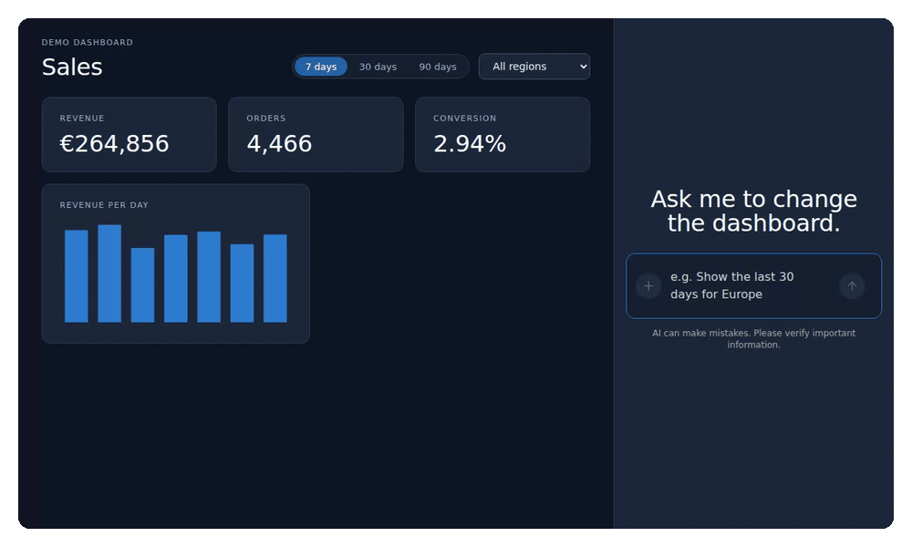
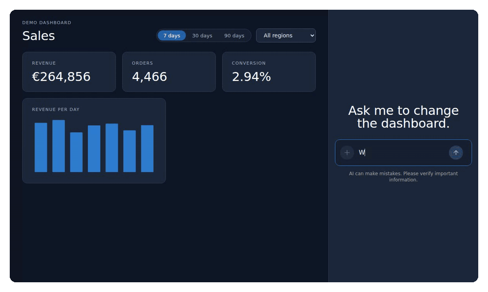
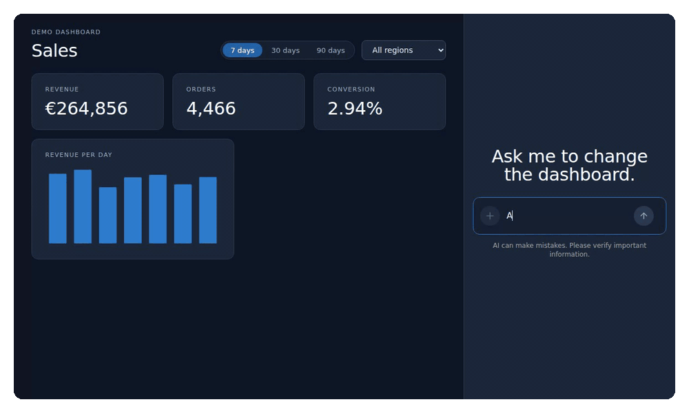

Most AI features in web apps are still a chat window bolted onto the side. You ask a question, you get text back, and then you go and click through the app yourself to do what the text told you. An *agentic UI* closes that gap. The agent can see what is on the screen, and it can act on the app through functions you give it. You say "show me Europe for the last 30 days", and the dashboard changes.

This is the first article in a series about building that kind of UI in Angular with [CopilotKit](https://www.copilotkit.ai/). In this one, we build a sales dashboard with a chat next to it. The agent will be able to read the dashboard, change its filters, and add and remove widgets:



> This article uses `@copilotkit/angular` 0.6.0 with Angular 22.2, and `@copilotkit/runtime` 1.84. Everything here was built and run in a real project, and the recordings are from a real browser session. The one exception is the language model: the recordings use a scripted test model instead of a paid one, so they are reproducible. More on that at the end.

## How the pieces fit together

There are three parts, and it helps to see them before writing any code.

- **The Angular app** shows the dashboard and the chat. With CopilotKit's Angular package, it also tells the agent what is on screen (*context*) and which functions it may call (*frontend tools*).
- **The runtime** is a small Node server from CopilotKit. It receives the conversation from the browser, talks to the language model, and streams everything back.
- **The language model** decides what to say and which tools to call.

The browser and the runtime talk to each other with AG-UI, an open protocol for streaming agent events: text, tool calls, results and state.

Here is what happens when you type "Show the last 30 days for Europe":

1. The Angular app sends your message to the runtime, together with the current dashboard context and the list of tools it offers.
2. The runtime passes all of that to the model.
3. The model answers with two tool calls: `set_date_range` with 30 days, and `set_region` with Europe.
4. The runtime streams those calls back to the browser.
5. CopilotKit runs the matching handlers in your Angular app. They update the dashboard's signals, and the dashboard re-renders.
6. The handlers' return values go back to the model, which writes the final answer.

The model never touches your app directly. It can only ask for one of the tools you registered, with arguments that are validated against a schema you wrote. Your Angular code decides what actually happens.

## Step 1: the runtime

The runtime is a few lines of Node:

```ts
// server.mjs
import http from 'node:http';
import { CopilotRuntime, BuiltInAgent } from '@copilotkit/runtime/v2';
import { createCopilotNodeListener } from '@copilotkit/runtime/v2/node';

const runtime = new CopilotRuntime({
  agents: {
    default: new BuiltInAgent({
      model: 'anthropic/claude-sonnet-4.5', // or an OpenAI or Google model; the API key comes from the environment
      prompt: 'You help the user explore their sales dashboard. Use the tools to change it.',
    }),
  },
});

const listener = createCopilotNodeListener({ runtime, basePath: '/api/copilotkit', cors: true });
http.createServer(listener).listen(4000);
```

`BuiltInAgent` is CopilotKit's ready-made agent: it sends the conversation to the model and handles tool calls. The `model` string picks a provider and a model, and the API key is read from the matching environment variable, such as `ANTHROPIC_API_KEY`. You can also connect agents built with other frameworks, but for a first project the built-in one is all you need.

Two things show up in the server log. The runtime sends telemetry unless you set `COPILOTKIT_TELEMETRY_DISABLED=true`. And it warns that listing and clearing conversation threads needs a user identity. That only matters once you add saved conversations, which is a later article.

In development, the Angular dev server can forward `/api` to the runtime, so the browser only talks to one origin:

```json
// proxy.conf.json, referenced from "serve.options.proxyConfig" in angular.json
{ "/api": { "target": "http://localhost:4000", "secure": false } }
```

## Step 2: CopilotKit in the Angular app

Install the package. It needs Angular 22, `@angular/cdk`, and `zod` for the tool schemas:

```bash
npm install @copilotkit/angular @angular/cdk zod@3
```

Then provide it in the application config, and import its stylesheet in `styles.css` with `@import '@copilotkit/angular/styles.css';`:

```ts
// app.config.ts
import { ApplicationConfig, provideBrowserGlobalErrorListeners } from '@angular/core';
import { provideCopilotChatLabels, provideCopilotKit } from '@copilotkit/angular';

export const appConfig: ApplicationConfig = {
  providers: [
    provideBrowserGlobalErrorListeners(),
    provideCopilotKit({ runtimeUrl: '/api/copilotkit', enableInspector: false, defaultToolRendering: true }),
    provideCopilotChatLabels({
      welcomeMessageText: 'Ask me to change the dashboard.',
      chatInputPlaceholder: 'e.g. Show the last 30 days for Europe',
    }),
  ],
};
```

Two of those options are worth explaining. In development, CopilotKit shows an *inspector*: a floating button that opens a debugging panel. It is useful when something goes wrong, but it sits on top of the chat, so I turned it off here. `defaultToolRendering: true` makes the chat show each tool call as a small row with its name and status, like `set_date_range · Complete` in the recordings. Without it, tool calls are invisible in the chat. CopilotKit hides them on purpose until you decide how to show them. Showing them with your own Angular components is what part 2 is about.

The chat itself is a ready-made standalone component. The app puts it next to the dashboard:

```ts
// app.ts
import { ChangeDetectionStrategy, Component } from '@angular/core';
import { CopilotChat } from '@copilotkit/angular';
import { Dashboard } from './dashboard/dashboard';
import { connectDashboardToCopilot } from './dashboard/dashboard-copilot';

@Component({
  selector: 'app-root',
  changeDetection: ChangeDetectionStrategy.OnPush,
  imports: [Dashboard, CopilotChat],
  template: `
    <main><app-dashboard /></main>
    <aside><copilot-chat /></aside>
  `,
})
export class App {
  constructor() {
    connectDashboardToCopilot();
  }
}
```

CopilotKit also has `<copilot-popup>` and `<copilot-sidebar>` if you prefer a floating or slide-in chat. The `connectDashboardToCopilot()` call is where the interesting part happens. We will get to it after a quick look at the dashboard.

## Step 3: the dashboard

The dashboard is ordinary Angular. Its state lives in a small store built on signals: the date range, the region, and the list of widgets on screen.

```ts
@Injectable({ providedIn: 'root' })
export class DashboardStore {
  readonly days = signal<RangeDays>(7);
  readonly region = signal<Region | 'All'>('All');
  readonly widgets = signal<Widget[]>([
    { id: 'w1', type: 'kpi', metric: 'revenue' },
    { id: 'w2', type: 'kpi', metric: 'orders' },
    { id: 'w3', type: 'kpi', metric: 'conversion' },
    { id: 'w4', type: 'chart', metric: 'revenue' },
  ]);

  readonly totals = computed(() => summarize(this.rows()));
  readonly revenueByRegion = computed(() => /* revenue per region in the selected range */);

  addWidget(type: Widget['type'], metric: Metric): Widget { /* … */ }
  removeWidget(id: string): boolean { /* … */ }
  // rows, series(metric), …
}
```

The KPI cards and charts read from this store, and the buttons and select at the top write to it. Nothing here knows about AI, and that is the point. The agent will work through the same store your own buttons use, so there is one source of truth and one set of rules.

## Step 4: let the agent see the dashboard

An agent that cannot see the screen has to guess. `connectAgentContext` gives it a description of what is there:

```ts
// dashboard-copilot.ts
import { computed, inject } from '@angular/core';
import { connectAgentContext, registerFrontendTool } from '@copilotkit/angular';
import { z } from 'zod';
import { DashboardStore } from './dashboard.store';
import { REGIONS } from './sales-data';

export function connectDashboardToCopilot(): void {
  const store = inject(DashboardStore);

  // What the agent can read. AG-UI context values are strings, so serialise the state.
  connectAgentContext(
    computed(() => ({
      description: 'The sales dashboard the user is looking at',
      value: JSON.stringify({
        dateRangeDays: store.days(),
        region: store.region(),
        totals: store.totals(),
        revenueByRegion: store.revenueByRegion(),
        widgets: store.widgets(),
      }),
    })),
  );

  // … tools, in the next step
}
```

A few details here are easy to get wrong.

The `value` must be a string. In AG-UI 1.0, a context entry is a description plus a string, so passing an object is a compile error. `JSON.stringify` it.

You can pass a function, so a `computed` works. CopilotKit reads it again before each run, so the agent gets the current state instead of a snapshot from when the page loaded.

It needs an injection context. `connectAgentContext` and the tool functions below use Angular's dependency injection, and they remove themselves when the component that called them is destroyed. That is why `connectDashboardToCopilot()` is called from a constructor. Put it in a component that lives as long as the feature, and the agent's abilities come and go with that feature.

To see what the model receives, I logged the prompt on the runtime. The context ends up in the system prompt, under a heading CopilotKit adds:

```
You help the user explore their sales dashboard. Use the tools to change it.
## Context from the application
The sales dashboard the user is looking at:
{"dateRangeDays":7,"region":"All","totals":{"revenue":264856,"orders":4466,"conversion":2.94},
 "revenueByRegion":{"Europe":87248,"North America":115474,"Asia":62134},"widgets":[…]}
```

So the agent can now answer questions about the dashboard without calling any tool at all:



Be deliberate about what you put in context. Everything in it is sent to the model on every turn: it costs tokens, and it leaves your browser. Send what the agent needs to understand the screen. Totals and the list of widgets, yes; ten thousand raw rows, no.

## Step 5: let the agent change the dashboard

Frontend tools are functions in your Angular app that the agent may call. Each one has a name, a description the model reads to decide when to use it, a zod schema for its arguments, and a handler:

```ts
  registerFrontendTool({
    name: 'set_date_range',
    description: 'Show the last 7, 30 or 90 days on the dashboard.',
    parameters: z.object({ days: z.union([z.literal(7), z.literal(30), z.literal(90)]) }),
    handler: async ({ days }) => {
      store.days.set(days);
      // Return the new state: the model reads tool results in this turn, context only on the next.
      return { days, region: store.region(), totals: store.totals() };
    },
  });

  registerFrontendTool({
    name: 'set_region',
    description: 'Filter the dashboard to one region, or All.',
    parameters: z.object({ region: z.enum(['All', ...REGIONS]) }),
    handler: async ({ region }) => {
      store.region.set(region);
      return { days: store.days(), region, totals: store.totals() };
    },
  });

  registerFrontendTool({
    name: 'add_widget',
    description: 'Add a KPI card or a per-day chart for a metric.',
    parameters: z.object({
      type: z.enum(['kpi', 'chart']),
      metric: z.enum(['revenue', 'orders', 'conversion']),
    }),
    handler: async ({ type, metric }) => store.addWidget(type, metric),
  });

  registerFrontendTool({
    name: 'remove_widget',
    description: 'Remove a widget by its id. The ids are in the dashboard context.',
    parameters: z.object({ id: z.string() }),
    handler: async ({ id }) => ({ removed: store.removeWidget(id) }),
  });
```

The schema does two jobs. CopilotKit turns it into the JSON schema the model sees, so the model knows that `days` can only be 7, 30 or 90. And the arguments that come back are typed: inside the handler, `days` is `7 | 30 | 90`, not `any`. Narrow schemas are a cheap guardrail. The model cannot ask for 45 days or a region you do not have.

The handlers call the same store methods the buttons use. That is the safe way to give an agent power over your UI: it gets exactly the actions a user has, through the same code paths, and nothing more.

`remove_widget` is a nice example of tools and context working together. The model does not know widget ids on its own, but they are in the context. When you say "remove the conversion card", it looks up the id of the conversion KPI there and calls `remove_widget` with it:



## The gotcha: context is one step behind inside a turn

This one cost me some time, so it gets its own section.

After the tools from the first request ran, I looked at the prompt the model received for its follow-up answer, the one that says "Done". The dashboard had already changed to Europe and 30 days, but the context in that prompt still said 7 days and all regions. The follow-up run starts right after the handlers return, before the updated context has been picked up. On the next message you type, the context is current again. I checked that as well.

So, within the turn where tools run, the model only knows what changed from what the tools *return*. That is why the handlers above return the new state instead of nothing. With that, the answer can say "Europe, last 30 days: €379,673 revenue from 6,483 orders" and be right. A handler that returns `void` leaves the model describing a dashboard that no longer exists.

## Before you ship it

A few things I found that matter outside a demo.

The bundle is big. With `@copilotkit/angular` 0.6.0, the initial bundle of this small app is 4.38 MB raw, about 1.46 MB over the wire, and a production build fails Angular's default 1 MB budget. My first idea was to load the chat lazily with `@defer`. That does not help today. CopilotKit's services are provided in the root injector and read the configuration from there, so `provideCopilotKit` has to be in `app.config.ts`. Importing it there pulls the whole package into the main bundle, with or without `@defer` around the chat. I also tried providing everything on a deferred component instead: that fails, because other root services inject `CopilotKit` from the root. For now, raise the budget deliberately, measure what it does to your load time, and keep an eye on the package's changelog.

Protect the runtime. The runtime is an endpoint that spends money on every request. Put it behind your normal authentication; `provideCopilotKit` accepts `headers` and `credentials` for exactly that. Treat it like any other API that costs money per call.

Tools are an API surface. Anything you register as a tool, a cleverly worded message can try to trigger. Keep tools to actions a user may already take, validate arguments with tight schemas, and do the real permission checks on the server, as you would for a button.

Context leaves the browser. Whatever you put into `connectAgentContext` goes to the model provider. Leave out personal data you would not send to a third party.

## How the recordings were made

The recordings are from a real Chromium session against the real runtime, with one substitution: the language model. There is no paid model behind them. Instead, the runtime uses the AI SDK's test model, set up to read the actual prompt CopilotKit sends, including the dashboard context and the tool results, and to reply with the same tool calls and text a real model would. Everything else is the real thing: the runtime, the built-in agent, the AG-UI stream, the Angular package, the tools and the context. In the server code, the only difference is the `model` option. Point it at a real model and set the API key, and the app works the same way. A real model will just word its answers in its own way.

## Next in the series

The tool calls in the chat are generic rows right now. In part 2, we replace them with Angular components: a chart preview, a confirmation card, a widget the user can click. After that comes human in the loop, where the agent asks before it does something you want to approve, and then shared state between your app and an agent that runs on the server.

If you want to bring agentic features like this into your own Angular application, and do it with the guardrails a production app needs, that is what my workshop [AI-Native Development: From Autocomplete to Automation](https://heckerssoftware.com/services/workshops#ai) covers, on your own codebase. Or [get in touch](https://heckerssoftware.com/#contactForm) if you would like help building it with your team.
