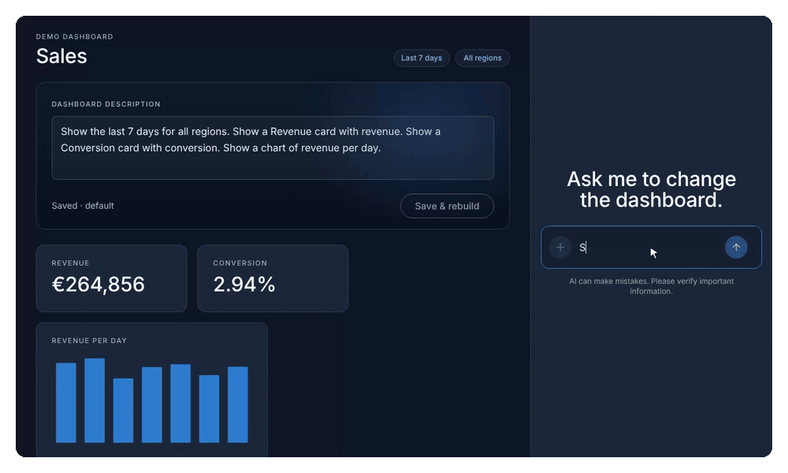

In [part 1](https://www.heckerssoftware.com/blog/copilotkit-angular-chat-driven-dashboard/) we gave a sales dashboard a chat that could read and change it, and in [part 2](https://www.heckerssoftware.com/blog/copilotkit-angular-dashboard-description/) one saved description started defining the whole dashboard. Through all of that, the chat itself stayed plain. Every change the agent made showed up as a grey row: `apply_dashboard · Complete`. True, but not very helpful. Which cards changed? What was the period before? And if the agent got it wrong, how do you get back?

In this part, the chat starts showing Angular components. When the agent changes the dashboard, you get a card that lists exactly what changed, with an **Undo** button. And when you ask a question that is best answered with a chart, the agent answers with a chart, right in the chat, which you can add to the dashboard in one click.



> Same setup as before: `@copilotkit/angular` 0.6.0 with Angular 22.2 and `@copilotkit/runtime` 1.84, run in a real browser. The recordings use a scripted test model instead of a paid one; everything else is real.

## How a component ends up in the chat

Every tool call the agent makes arrives in the browser as a message in the conversation. By default, CopilotKit does not show those at all, and with `defaultToolRendering: true` from part 1 it shows the generic row. You can replace that row with your own component for any tool.

The component is an ordinary standalone Angular component with one required signal input, `toolCall`. CopilotKit creates it inside the chat and keeps that input up to date while the call goes through three stages:

- **`in-progress`**: the model is still sending the arguments. They stream in, so `args` may be incomplete.
- **`executing`**: the arguments are complete, and the tool's handler is running.
- **`complete`**: the handler is done. `result` now holds what the handler returned, as a string.

Because `toolCall` is a signal, the component simply derives what to show with `computed`, and Angular re-renders it as the stages pass. It can also inject your services like any other component: both components in this article inject the `DashboardStore` from part 2.

CopilotKit's Angular package has three ways to attach a component, and the difference is about who owns the tool:

- **`registerFrontendTool({ ..., component })`**: the tool from part 2, with a `component` added. The handler still runs in the browser; the component shows the call.
- **`registerComponent(...)`**: a tool whose only job is to show a component. There is no handler. The agent calls it to put your component in the chat.
- **`registerRenderToolCall(...)`**: a component for a tool the agent already has on its own, for example one that runs on the server. You only add the rendering, by tool name or with `"*"` for all of them.

This article uses the first two.

## A card that shows what changed

The `apply_dashboard` tool from part 2 replaces the whole dashboard at once. That is good for keeping the description and the spec in sync, but it makes the chat row even less informative: "the dashboard was replaced" says nothing about *what* changed.

So the handler now returns one more thing: what the dashboard was before. It also returns the time the change was applied, which becomes important for the undo button:

```ts
registerFrontendTool({
  name: 'apply_dashboard',
  description: /* as in part 2 */,
  parameters: z.object({ description: z.string().min(1), spec: dashboardSpec }),
  component: DashboardChange,
  handler: async ({ description, spec }) => {
    const previous = { description: store.description(), spec: store.spec() };
    store.apply(description, spec);
    // The renderer uses previous and appliedAt; the model reads the rest.
    return { applied: true, appliedAt: store.active().updatedAt, previous, description, spec, totals: store.totals() };
  },
});
```

The one new line in the registration is `component: DashboardChange`. Everything else is the tool from part 2.

The component compares the old spec with the new one, and lists the differences in words:

```ts
@Component({
  selector: 'app-dashboard-change',
  template: `
    @if (result(); as r) {
      <div class="chat-card-title">Dashboard updated</div>
      <ul class="changes">
        @for (c of changes(); track c.text) {
          <li [class]="c.kind"><span class="sign">{{ c.kind === 'added' ? '+' : c.kind === 'removed' ? '−' : '~' }}</span>{{ c.text }}</li>
        } @empty {
          <li class="changed"><span class="sign">~</span>Description reworded, same dashboard</li>
        }
      </ul>
      <div class="chat-card-actions">
        @if (undone()) {
          <span class="note">Undone. The dashboard is back to how it was.</span>
        } @else if (canUndo()) {
          <button type="button" class="secondary" (click)="undo(r)">Undo</button>
        } @else {
          <span class="note">Changed again since, so this can no longer be undone here.</span>
        }
      </div>
    } @else {
      <div class="chat-card-title pending">Updating the dashboard…</div>
    }
  `,
  host: { class: 'chat-card' },
})
export class DashboardChange {
  readonly toolCall = input.required<AngularToolCall<{ description: string; spec: DashboardSpec }>>();
  private readonly store = inject(DashboardStore);

  protected readonly result = computed(() => {
    const call = this.toolCall();
    return call.status === 'complete' ? (JSON.parse(call.result) as ApplyResult) : null;
  });
  protected readonly changes = computed(() => {
    const r = this.result();
    return r ? diffSpecs(r.previous.spec, r.spec) : [];
  });
  /** Only offer undo while the dashboard is still exactly what this call produced. */
  protected readonly canUndo = computed(() => this.result()?.appliedAt === this.store.active().updatedAt);
  protected readonly undone = signal(false);

  protected undo(r: ApplyResult): void {
    this.store.apply(r.previous.description, r.previous.spec);
    this.undone.set(true);
  }
}
```

A few details are worth pointing out.

The result is a string. Whatever the handler returns, CopilotKit serialises it before it reaches the component, so `result` is JSON text and the component parses it. The types say so too: `result` is `string` once the status is `complete`.

Until the call completes, the card says "Updating the dashboard…". You could show the arguments while they stream in, but for this tool the useful information is the comparison with the old dashboard, and that only exists once the handler has run.

`diffSpecs` is a plain function of about thirty lines, with no Angular in it. It compares the period and the region, and matches widgets between the two specs: cards by title, charts by metric and scope. What is in the new spec and not in the old one is added, what is gone is removed, and a card whose fields changed is changed. A request like "show the last 30 days for Europe and add a chart of sales per day" then reads as:

```
~ Period: last 7 → last 30 days
~ Region: All → Europe
+ Sales chart
```

That is a much better answer to "what did you just do?" than any sentence the model could write, because it is computed from the actual specs, not described by the agent.

## Undo, and when not to offer it

Undo puts the previous description and spec back. It goes straight to the store and does not involve the agent: it is the user's own action, it should be instant and free, and it should restore the description word for word. The agent finds out on the next message, because the context it receives is always the current dashboard.

The interesting part is when *not* to offer it. The card stays in the chat. If the agent changes the dashboard again afterwards, the first card's "previous" is two changes ago, and undoing it would also throw away the second change without saying so. So the card only offers Undo while the dashboard is still exactly the one this call produced. The handler returned the `updatedAt` of the dashboard it created, and `canUndo` compares that with the current one. As soon as anything else changes the dashboard, whether that is the agent, the description editor or another card, the button is replaced with "Changed again since, so this can no longer be undone here." I tested that state as well: after a second change, the first card shows exactly that note.

It is a small thing, but it is what makes a button in a chat history trustworthy. Old messages stay on screen, and every button in them acts on today's state, not on the state they were created in.

## A chart as the answer

Some questions are best answered with a picture. "Show me visits per day for Asia over the last 14 days" deserves a chart, not a sentence, and it should not change the dashboard just because you were curious.

That is what `registerComponent` is for:

```ts
registerComponent({
  name: 'show_chart',
  description:
    'Answer a question with a per-day chart in the chat, without changing the dashboard. ' +
    'The user can add it to the dashboard from there.',
  parameters: z.object({ metric: z.enum(['revenue', 'sales', 'visits']), ...ownScope }),
  component: ChartPreview,
  followUp: false,
});
```

To the model, this is just another tool, with a name, a description and a schema. `ownScope` is the optional `region` and `days` from part 2, reused, so the model can ask for "Asia, 14 days". There is no handler. When the model calls it, CopilotKit puts `ChartPreview` in the chat with the arguments.

`followUp: false` tells CopilotKit not to run the agent again after the tool call. Normally, after a tool, the agent gets a second turn to say something about the result, which is how the "Done." messages in part 1 came about. Here, the chart *is* the answer, and a second turn would only add "Here is your chart." underneath it. I checked the effect in the test: the chart question made one model call, where every other request made two.

The component reuses the chart from the dashboard:

```ts
@Component({
  selector: 'app-chart-preview',
  imports: [ChartCard],
  template: `
    @if (scope(); as s) {
      <app-chart [metric]="s.metric" [region]="s.region" [days]="s.days" />
      <div class="chat-card-actions">
        @if (onDashboard()) {
          <span class="note">On the dashboard.</span>
        } @else {
          <button type="button" class="primary" (click)="addToDashboard()">Add to dashboard</button>
        }
      </div>
    } @else {
      <div class="chat-card-title pending">Drawing a chart…</div>
    }
  `,
  host: { class: 'chat-card preview' },
})
export class ChartPreview {
  readonly toolCall = input.required<AngularToolCall<ShowChartArgs>>();
  private readonly store = inject(DashboardStore);

  /** The chart's full scope, pinned at the moment it was asked for. Arguments stream in, so wait for the metric. */
  protected readonly scope = computed(() => {
    const { metric, region, days } = this.toolCall().args as Partial<ShowChartArgs>;
    if (!metric) return null;
    return { metric, ...this.store.scopeOf({ region, days }) };
  });

  protected readonly onDashboard = computed(() => {
    const s = this.scope();
    return !!s && this.store.spec().widgets.some(
      (w) => w.type === 'chart' && w.metric === s.metric && w.region === s.region && w.days === s.days,
    );
  });

  protected addToDashboard(): void {
    const s = this.scope();
    if (!s) return;
    const where = s.region === 'All' ? 'all regions' : s.region;
    this.store.addWidget(
      { type: 'chart', metric: s.metric, region: s.region, days: s.days },
      `Show a chart of ${s.metric} per day for ${where} for the last ${s.days} days.`,
    );
  }
}
```

`<app-chart>` is the same `ChartCard` the dashboard renders, with the region and days inputs from part 2. The chart in the chat and the chart on the dashboard are the same component, reading the same store, so they can never disagree. The only extra styling is a rule that drops the card border inside the chat.

Two details here are easy to get wrong.

The arguments stream in. During `in-progress`, `args` can be partial, so the component waits until there is a metric before it draws anything. That is why `scope` returns `null` until then, and the template shows "Drawing a chart…".

The scope is pinned. `scopeOf` fills in whatever the model left out from the dashboard's own region and days, and the preview passes the result explicitly to the chart. If the model asks for "visits per day" without a period, and the dashboard is on 7 days, the preview shows 7 days, and keeps showing 7 days even if you later change the dashboard to 30. A chart in a chat history should keep showing what it showed when it was asked for.


## Keeping the description in sync

**Add to dashboard** changes the dashboard without the agent, like Undo. But the dashboard from part 2 is defined by a description, and that description has to keep matching the spec. So the button does not just add a widget: it adds a widget *and* the sentence that describes it, in one call to the store:

```ts
/** Add one widget and the sentence that describes it, so description and spec stay in sync. */
addWidget(widget: WidgetSpec, sentence: string): void {
  const { description, spec } = this.active();
  this.apply(`${description.trim()} ${sentence}`, { ...spec, widgets: [...spec.widgets, widget] });
}
```

After the click in the recording, the description ends with "Show a chart of visits per day for Asia for the last 14 days.", and the new chart on the dashboard wears the chip "Asia · last 14 days" from part 2, because it has its own scope. The preview changes to "On the dashboard.", because `onDashboard` finds a matching widget in the spec, so the same chart cannot be added twice.

Writing that sentence in code is fine here, because the widget is fully known and the sentence is mechanical. The agent writes descriptions when the request is open-ended; the app writes them when the change is exact.

## What to keep an eye on

The tool result goes to the model. `previous` makes the `apply_dashboard` result bigger, and everything the handler returns is sent back to the model in the follow-up turn. For a dashboard spec, that is a few hundred tokens. For larger data, keep what only the renderer needs somewhere else, for example in a service keyed by the tool call, and return only what the model should read.

Cards outlive their meaning. Anything a component in the chat can do, it can do long after it was created. Undo is guarded by `updatedAt`; "Add to dashboard" checks the spec. Any action you put on a card needs the same question asked of it: is this still true right now?

The chat is not saved yet. Reload the page and the conversation is gone, cards included. The dashboard itself survives, as in part 2. Saving conversations needs the user identity the runtime warned about in part 1, and is a topic of its own.

This shows a change after it happened. In part 2, I mentioned a preview of a change *before* it is applied. Doing that properly means the agent has to stop and wait for the user to approve, which is human in the loop. That is part 4.

## Next in the series

Part 4 is human in the loop: the agent proposes a change, the chat shows it as a component with **Apply** and **Cancel**, and nothing happens until you choose. After that comes shared state between your app and an agent that runs on the server.

If you want to bring features like this into your own Angular application, my workshop [AI-Native Development: From Autocomplete to Automation](https://heckerssoftware.com/services/workshops#ai) covers them on your own codebase. Or [get in touch](https://heckerssoftware.com/#contactForm) if you would like help building it with your team.
