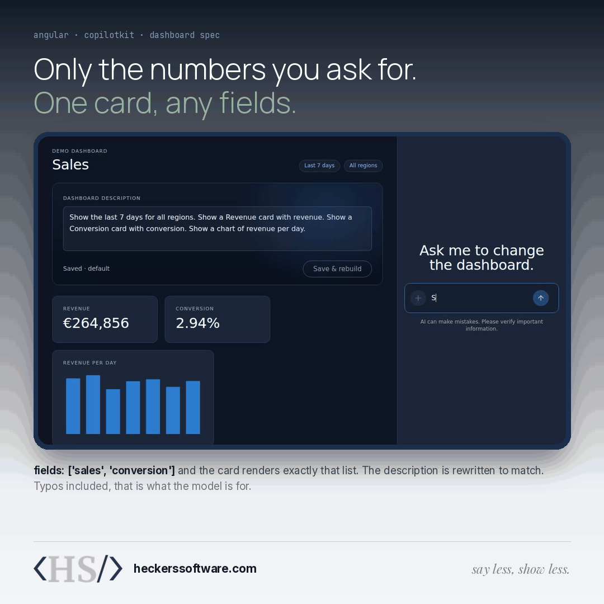
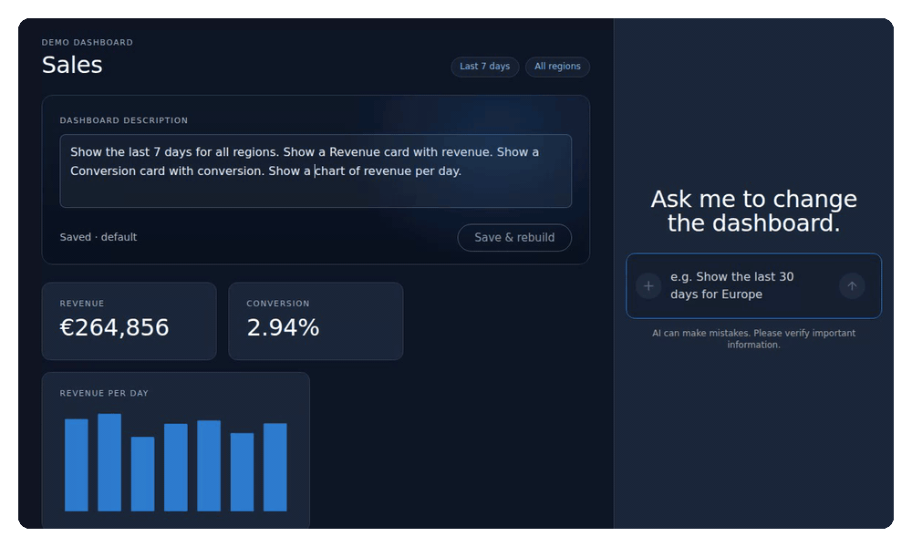

In [part 1](https://www.heckerssoftware.com/blog/copilotkit-angular-chat-driven-dashboard/), we built a sales dashboard with a chat next to it. The agent could read the dashboard and change it through functions we gave it. It worked well, but there was one thing missing: nothing was kept. Reload the page and your dashboard was back to the default, and the only record of what you asked for was a chat history that was gone too.

In this part, the dashboard gets one *active description*: a few plain sentences that define what it shows. You can change it by talking to the chat, or by editing the text yourself. Either way it is saved, the dashboard rebuilds from it, and when you come back later it looks exactly the same. Cards also get more precise: you decide which numbers each card shows.



> Same setup as part 1: `@copilotkit/angular` 0.6.0 with Angular 22.2 and `@copilotkit/runtime` 1.84, run in a real browser. As before, the recordings use a scripted test model instead of a paid one; everything else is real.

## The one decision that makes this work

The idea sounds simple: save the description, and when the app loads, give it to the agent to build the dashboard. That is exactly what *not* to do.

A language model does not give the same answer every time. Ask it twice to build a dashboard from the same sentences, and you can get the cards in a different order, a different title, or one field more or less. You would also pay for a model call every time someone opens the page, and wait for it before seeing anything.

So the app saves two things together:

- **The description**: the sentences you read and edit.
- **The spec**: a small, structured version of the same dashboard, in a fixed shape the app understands: the date range, the region, and the list of cards and charts, with the fields each card shows.

The dashboard renders from the spec, not from the description. The model only runs when the description *changes*. When that happens, it produces a new spec, and the two are saved together. You can think of the spec as the compiled form of the description: you change the source, it gets compiled once, and from then on the app runs the compiled version.

I checked this in the test. Two chat edits and one manual rebuild made six model calls in total (each request is one call to decide on the change and one to answer afterwards). Reloading the page made none, and rendered exactly the same dashboard.

## The spec

The spec is plain TypeScript:

```ts
export type Field = 'revenue' | 'sales' | 'visits' | 'conversion';
export type ChartMetric = 'revenue' | 'sales' | 'visits';

/** What a widget covers: a region (or all) and a number of days, 1 to 90. */
export interface Scope {
  days: number;
  region: Region | 'All';
}

/** A widget inherits the dashboard's scope unless it sets its own region or days. */
export type WidgetSpec =
  | { type: 'card'; title: string; fields: Field[]; region?: Region | 'All'; days?: number }
  | { type: 'chart'; metric: ChartMetric; region?: Region | 'All'; days?: number };

export interface DashboardSpec extends Scope {
  widgets: WidgetSpec[];
}

/** The one active dashboard: the description you edit and the spec it produced, saved together. */
export interface ActiveDashboard {
  description: string;
  spec: DashboardSpec;
  updatedAt: string;
}
```

The `fields` list on a card is what makes "only sales and conversion" possible. A card shows exactly the fields in its list, in that order, and nothing else.

The optional `region` and `days` on a widget came from a request I had not planned for: "a revenue card for Europe for the past 7 days, and a revenue card for Asia for the past 14 days". My first version had one region and one period for the whole dashboard, and widgets carried neither. That request produced two cards with identical numbers and nothing on them to say which region they showed, and the 14 days had silently become 7, because `days` was fixed to 7, 30 or 90. So a widget may now set its own scope, and uses it instead of the dashboard's. A widget without one behaves as before. Days are any number from 1 to 90, which is what the sample data holds.

## The store

The store now holds one signal: the active dashboard. It loads it from storage when the app starts, and saves it whenever it changes:

```ts
const STORAGE_KEY = 'dashboard.active';

@Injectable({ providedIn: 'root' })
export class DashboardStore {
  readonly active = signal<ActiveDashboard>(load());
  readonly description = computed(() => this.active().description);
  readonly spec = computed(() => this.active().spec);

  constructor() {
    // Every change to the active dashboard is saved, so a reload renders exactly the same.
    effect(() => localStorage.setItem(STORAGE_KEY, JSON.stringify(this.active())));
  }

  /** Replace the active dashboard. Called by the agent's tool. */
  apply(description: string, spec: DashboardSpec): void {
    this.active.set({ description, spec, updatedAt: new Date().toISOString() });
  }

  /** A widget's own region and days, falling back to the dashboard's. */
  scopeOf(own: Partial<Scope>): Scope {
    const base = this.spec();
    return { days: own.days ?? base.days, region: own.region ?? base.region };
  }

  // totalsFor(scope), seriesFor(metric, scope) and the rest read the data in that scope
}
```

`load()` reads the saved value, and falls back to a default description and spec when there is none. Everything else in the store, like the totals and the chart data, is computed for a scope, and every scope comes from `spec()`, so the whole dashboard follows from that one value.

`localStorage` keeps this example small. In a real app, you would save the active dashboard per user on your server, so it follows people across devices. The idea stays the same: save the description and the spec together, and render from the spec.

## One tool instead of four

In part 1, the agent had four small tools: change the date range, change the region, add a widget, remove a widget. That works, but it makes it hard to keep a description truthful. After four separate small changes, who rewrites the sentences?

So this version has one tool that replaces the whole active dashboard at once, description and spec together:

```ts
const field = z.enum(['revenue', 'sales', 'visits', 'conversion']);
const region = z.enum(['All', ...REGIONS]);
const days = z.number().int().min(1).max(90).describe('Number of days up to today, 1 to 90');

/** A widget may cover something other than the dashboard; without these it follows the dashboard's region and days. */
const ownScope = {
  region: region.optional().describe('Only this region. Omit to use the dashboard region.'),
  days: days.optional().describe('Only the last N days. Omit to use the dashboard days.'),
};

const dashboardSpec = z.object({
  days,
  region,
  widgets: z.array(
    z.discriminatedUnion('type', [
      z.object({ type: z.literal('card'), title: z.string().min(1), fields: z.array(field).min(1).max(4), ...ownScope }),
      z.object({ type: z.literal('chart'), metric: z.enum(['revenue', 'sales', 'visits']), ...ownScope }),
    ]),
  ),
});

registerFrontendTool({
  name: 'apply_dashboard',
  description:
    'Replace the active dashboard. Always send the complete spec, and a description that says in plain ' +
    'sentences exactly what the spec shows, so the two stay in sync. Cards show only the fields listed, in order. ' +
    'The dashboard has one region and one number of days; a card or chart that should cover a different region ' +
    'or period sets its own region and days, so two Revenue cards for different regions are two widgets.',
  parameters: z.object({ description: z.string().min(1), spec: dashboardSpec }),
  handler: async ({ description, spec }) => {
    store.apply(description, spec);
    // Return the new state: the model reads tool results in this turn, context only on the next.
    return { applied: true, description, spec, totals: store.totals() };
  },
});
```

A few things here are deliberate.

The tool always receives the complete dashboard. Replacing everything at once means the description and the spec are always saved as a pair, and there is never a half-applied change.

The tool's `description` is an instruction to the model. The model reads it to decide how to use the tool, so it says plainly what we need: send the complete spec, and a description that matches it. The last sentence is there because of the two revenue cards: without it, a model may well decide that a second card with the same title replaces the first.

The zod schema is the contract. `discriminatedUnion` describes the two kinds of widget, and `.min(1).max(4)` keeps cards from being empty or overloaded. `.describe()` on a field ends up in the JSON schema the model sees, which is the right place to say what an optional field means and what happens when it is left out. The model sees this schema, and the handler receives typed arguments.

To see what happens when the model ignores the contract, I made the test model send a spec with a 400-day range, a region called "Mars" and a card with a `profit` field. None of it reached the dashboard: the store and the saved data stayed exactly as they were. But the chat still showed the call as "Complete", and no answer followed, so the user got no explanation. Treat the schema as a safety net, not as error handling. If you want the agent to recover from a bad call, validate in the handler as well and return a clear error it can act on.

The context still tells the agent what is on screen, now as the description, the spec and the totals:

```ts
connectAgentContext(
  computed(() => ({
    description: 'The active dashboard: the description the user wrote and the spec it currently renders',
    value: JSON.stringify({ description: store.description(), spec: store.spec(), totals: store.totals() }),
  })),
);
```

This matters for edits. When you say "show me the conversion card with only sales and conversion", the agent needs the current spec to change one card and keep everything else as it was.

## Cards that show exactly what you ask for

The card component simply renders the fields from its spec, in order, over the card's own scope. The first field is shown large, without a label when it would only repeat the card's title:

```ts
@Component({
  selector: 'app-card',
  template: `
    <div class="label">{{ title() }}</div>
    @if (scoped()) { <span class="chip scope">{{ scopeLabel() }}</span> }
    @for (row of rows(); track row.field; let first = $first) {
      <div class="row" [class.primary]="first">
        <span>{{ first && row.label === title() ? '' : row.label }}</span><strong>{{ row.value }}</strong>
      </div>
    }
  `,
})
export class Card {
  readonly title = input.required<string>();
  readonly fields = input.required<Field[]>();
  readonly region = input<Region | 'All'>();
  readonly days = input<number>();
  private readonly store = inject(DashboardStore);
  protected readonly scoped = computed(() => this.region() !== undefined || this.days() !== undefined);
  private readonly scope = computed(() => this.store.scopeOf({ region: this.region(), days: this.days() }));
  protected readonly scopeLabel = computed(() => describeScope(this.scope())); // "Asia · last 14 days"
  protected readonly rows = computed(() => {
    const totals = this.store.totalsFor(this.scope());
    return this.fields().map((field) => ({ field, label: LABEL[field], value: formatField(field, totals[field]) }));
  });
}
```

A card with its own region or period wears it as a chip under the title, so two Revenue cards are never two identical boxes. A card that inherits the dashboard's scope shows nothing extra: the chips in the header already say what that is.

That is all it takes for the two requests from the recording at the top. "Show me the conversion card including the total visits, sales and the convertion" becomes a card with `['visits', 'sales', 'conversion']`. "Show me the convertion card with only the total sales and convertion percentage" becomes `['sales', 'conversion']`, and the visits row disappears. The spelling is not a problem: understanding what someone meant is exactly what the model is for. Each time, the description is rewritten to match: "Show a Conversion card with sales and conversion."

## Editing the description yourself

Talking to the chat is not always the fastest way. Sometimes you just want to change "7 days" to "30 days". So the description is shown above the dashboard as an editable text, with a **Save & rebuild** button:

```ts
@Component({
  selector: 'app-description',
  template: `
    <label for="desc">Dashboard description</label>
    <textarea id="desc" rows="3" [value]="draft()" (input)="draft.set($any($event.target).value)"></textarea>
    <div class="actions">
      <span class="status">{{ dirty() ? 'Unsaved changes' : 'Saved · ' + savedAt() }}</span>
      <button type="button" [disabled]="!dirty() || busy()" (click)="rebuild.emit(draft())">Save & rebuild</button>
    </div>
  `,
})
export class DescriptionEditor {
  readonly busy = input(false);
  readonly rebuild = output<string>();
  private readonly store = inject(DashboardStore);
  /** A local draft that resets whenever the saved description changes, e.g. after a chat edit. */
  protected readonly draft = linkedSignal(() => this.store.description());
  protected readonly dirty = computed(() => this.draft().trim() !== this.store.description().trim());
  // savedAt…
}
```

`linkedSignal` is a good fit for a draft. It is a writable signal, so typing updates it, but it is also linked to the saved description. When the saved description changes, for example because the chat just rewrote it, the draft resets to the new text. Without that, the text box would keep showing an old version after every chat edit.

When you press the button, the app sends the new description to the agent as a normal chat message, using CopilotKit's headless agent API:

```ts
export class App {
  private readonly copilotKit = inject(CopilotKit);
  private readonly agent = injectAgentStore('default');
  protected readonly busy = computed(() => this.agent().isRunning());

  protected async rebuild(description: string): Promise<void> {
    const agent = this.agent().agent;
    agent.addMessage({
      id: crypto.randomUUID(),
      role: 'user',
      content: `Rebuild the dashboard from this description: ${description}`,
    });
    await this.copilotKit.core.runAgent({ agent });
  }
}
```

`injectAgentStore` gives you the agent behind the chat, with signals like `isRunning()`, which disables the button while the agent works. Adding a message and calling `runAgent` is exactly what the chat does when you type, so the request shows up in the conversation like any other. That is on purpose: the user can always see what was asked and what changed.

There is one difference between the two ways of editing. When you edit the description yourself, your own words are kept and the agent only produces the spec from them. When you edit through the chat, the agent rewrites the description to match the new spec. Both end with a description and a spec that agree.



The end of that recording is the point of this article. After the reload, the chat is empty, but the dashboard and its description are exactly as they were.

## What to keep an eye on

Descriptions and specs can drift apart. The agent writes both, and nothing forces them to agree except the instruction in the tool. Showing the spec in a visible way helps: the chips at the top show the date range and region straight from the spec, and the chip on a card with its own scope comes straight from that widget, so a mismatch is easy to spot. You could also skip the model's description for chat edits and generate the sentences from the spec yourself, which guarantees they match.

One active version is not a history. Right now every change replaces the previous one. Saving older versions gives you undo, and a list of named dashboards is a small step from there.

What you save is what you render. Because the spec is validated before it is applied, a stored dashboard is always one the app knows how to draw. If you ever change the shape of the spec, plan a migration for the dashboards people have already saved, as you would for any stored data. That came up once while writing this: the region and days on a widget were added after the first version. Because they are optional, a dashboard saved before still loads, and a widget without them behaves exactly as it did.

## Next in the series

The tool calls in the chat are still the generic rows CopilotKit shows by default. In part 3, we replace them with real Angular components rendered inside the chat, such as a preview of the change before it is applied.

If you want to bring features like this into your own Angular application, my workshop [AI-Native Development: From Autocomplete to Automation](https://heckerssoftware.com/services/workshops#ai) covers them on your own codebase. Or [get in touch](https://heckerssoftware.com/#contactForm) if you would like help building it with your team.
