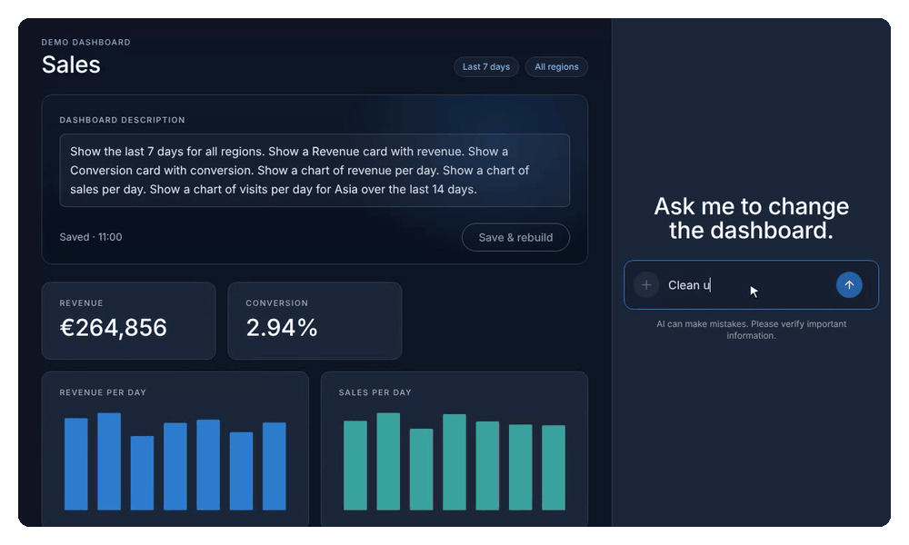
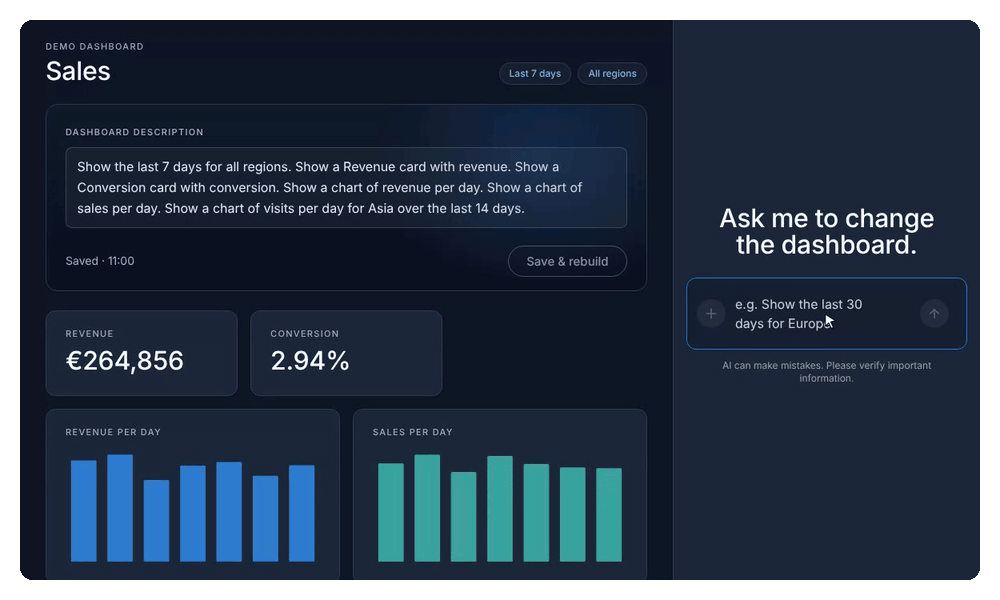

In [part 3](https://www.heckerssoftware.com/blog/copilotkit-angular-components-in-chat/), the chat started showing Angular components. When the agent changed the dashboard, you got a card listing exactly what changed, with an **Undo** button. That works well for most changes: they are small, you see them happen, and you can take them back.

Some changes deserve a question first. In this part, the agent asks before it removes anything from the dashboard. It shows the widgets it wants to remove, one checkbox each, and then it waits. You untick what you want to keep, press **Remove 2 widgets** or **Keep all**, and the agent continues with your answer.



> Same setup as before: `@copilotkit/angular` 0.6.0 with Angular 22.2 and `@copilotkit/runtime` 1.84, run in a real browser. The recordings use a scripted test model instead of a paid one; everything else is real.

## Asking is not the same as undo

Part 3 already had buttons on cards, and one of them, **Add to dashboard**, also lets the user decide before something lands on the dashboard. So it is worth being precise about what is new here. The difference is who is waiting for whom.

| Aspect | Part 3: Undo | Part 3: Add to dashboard | Part 4: Approve |
| --- | --- | --- | --- |
| When | After the agent acted | After the agent answered | Before the agent acts |
| Who starts it | The agent | The user picks up a suggestion | The agent asks |
| Is the agent waiting? | No | No | Yes |
| When the agent learns the outcome | Next message, from the context | Next message, from the context | Right away, as the tool result |

"Add to dashboard" is a suggestion. The agent's turn is over, nothing is pending, and if you never click, nothing happens. Undo is "act first, take it back later".

Human in the loop is the agent asking permission and *waiting for the answer*. The run pauses on a tool call. Your choice goes back to the agent as that tool's result, in the same turn, and the agent continues from it. That is what makes partial answers possible: you approve two of three removals, and the agent removes exactly those two and tells you which one it kept.

## When to ask

Asking for every change gets tiresome quickly. Nobody wants to approve "show the last 30 days". So the first decision is not about the API, it is about where the line goes.

In this dashboard, I put it at removals. Adding a widget or changing the period is cheap, visible and covered by Undo. Removing widgets in bulk is different: "clean up the dashboard" can take away something you check every morning, and a list of removed items in a chat card is easy to scroll past. So additions and changes apply directly, and removals ask first.

Your own line will be somewhere else. In a real application, the clear cases are actions that leave the screen: sending something, sharing a dashboard with a team, deleting data, anything that costs money. The test I use is simple: if Undo would not fully take it back, or if the user might not notice it happened, ask first.

## How a question works in CopilotKit

CopilotKit's Angular package has a function for this: `registerHumanInTheLoop`. It registers a tool, like `registerFrontendTool` from the earlier parts, but with two differences:

- There is no handler. The tool's "handler" is the user.
- The component's `toolCall` input has one extra member: `respond(result)`. Calling it finishes the tool call, and whatever you pass becomes the tool result the agent continues with.

Underneath, it is small, and worth knowing because the details matter later. The tool CopilotKit registers returns a promise that waits for an answer on a shared stream, filtered by the tool call's id. `respond` pushes the answer onto that stream. The promise takes the first answer and stops listening, so a second `respond` for the same call does nothing.

While it waits, the component goes through the same statuses as in part 3. One of them matters here:

- **`in-progress`**: the model is still sending the arguments. Nobody is waiting for an answer yet.
- **`executing`**: the tool is running, which for a human-in-the-loop tool means: waiting for you. I checked this in the browser; for the whole time the question is open, the status is `executing`.
- **`complete`**: answered. `result` holds the answer as a JSON string.

The stream does not keep old answers. An answer given while the status is still `in-progress` arrives before anyone is listening, and it is lost; the agent would wait forever. So the card only accepts an answer while the status is `executing`.

## The tool

```ts
registerHumanInTheLoop({
  name: 'confirm_removal',
  description:
    'Ask the user before removing widgets from the dashboard. List each widget exactly as it appears in the spec. ' +
    'The result says which removals the user approved; afterwards call apply_dashboard and remove only those.',
  parameters: z.object({
    reason: z.string().describe('One short sentence on why these widgets should go'),
    widgets: z.array(widget).min(1),
  }),
  component: ConfirmRemoval,
});
```

`widget` is the widget schema from part 2, now pulled out of the dashboard spec into its own constant so both tools can use it. The agent proposes widgets in exactly the shape the spec uses, so the card can find them on the dashboard.

The `apply_dashboard` tool from part 2 gets one more sentence in its description: "Removing a widget needs the user's approval: call confirm_removal first, and remove only what was approved." That sentence asks the model to behave. The next sections make sure it has to.

## The card

The card lists the proposed widgets, each with a checkbox, and two buttons. Here is the core of it:

```ts
@Component({
  selector: 'app-confirm-removal',
  template: `
    <div class="chat-card-title">{{ decided() ? 'Your choice' : 'Remove these widgets?' }}</div>
    @if (call().args.reason; as reason) { <p class="reason">{{ reason }}</p> }
    <!-- the checklist while open, the decision once answered -->
    <div class="chat-card-actions">
      @if (decided(); as d) {
        <span class="note">{{ summary(d) }}</span>
      } @else if (open()) {
        <button type="button" class="primary" [disabled]="chosen().length === 0" (click)="decide(chosen())">
          Remove {{ chosen().length }} {{ chosen().length === 1 ? 'widget' : 'widgets' }}
        </button>
        <button type="button" class="secondary" (click)="decide([])">Keep all</button>
      } @else {
        <span class="note">Waiting for the proposal…</span>
      }
    </div>
  `,
})
export class ConfirmRemoval {
  readonly toolCall = input.required<HumanInTheLoopToolCall<ConfirmRemovalArgs>>();
  private readonly store = inject(DashboardStore);
  private readonly approvals = inject(RemovalApprovals);

  protected readonly call = computed(() => this.toolCall());
  /** Only answer once the tool is actually waiting: an answer given earlier has nobody listening and is lost. */
  protected readonly open = computed(() => this.call().status === 'executing' && !this.decided());

  /** Every proposed widget, checked against the dashboard as it is right now. */
  protected readonly items = computed(() => {
    const onDashboard = new Set(this.store.spec().widgets.map(keyOf));
    const unchecked = this.unchecked();
    return (this.call().args.widgets ?? []).map((w) => {
      const key = keyOf(w);
      const present = onDashboard.has(key);
      return { key, name: nameOf(w), present, checked: present && !unchecked.has(key) };
    });
  });
  protected readonly chosen = computed(() => this.items().filter((i) => i.checked).map((i) => i.key));

  private readonly unchecked = signal(new Set<string>());
  /** Once answered, the decision is shown from the tool result, so it survives the component being recreated. */
  protected readonly decided = linkedSignal<RemovalDecision | null>(() => {
    const c = this.call();
    return c.status === 'complete' ? (JSON.parse(c.result) as RemovalDecision) : null;
  });

  protected decide(keys: string[]): void {
    if (!this.open()) return;
    const items = this.items();
    const decision: RemovalDecision = {
      approved: items.filter((i) => keys.includes(i.key)).map((i) => i.name),
      declined: items.filter((i) => i.present && !keys.includes(i.key)).map((i) => i.name),
      alreadyGone: items.filter((i) => !i.present).map((i) => i.name),
    };
    this.approvals.approve(keys);
    this.decided.set(decision);
    this.call().respond(decision);
  }
  // toggle(key) and summary(decision) are a few lines each
}
```

A few details are worth pointing out.

`keyOf` and `nameOf` come from the `diffSpecs` helper of part 3. `keyOf` is a widget's identity: its kind, its title or metric, and its own region and days. I changed it slightly for this part: in part 3, cards were matched by title only, but "the Revenue card for Europe" and "the Revenue card for Asia" are two different widgets, and the one you approve removing has to be the one that gets removed.

The checklist is computed from the dashboard as it is *now*, not as it was when the agent asked. More on why in a moment.

`decided` is a `linkedSignal`. Clicking a button sets it right away, so the card switches to "Your choice" without waiting for anything. But it is also linked to the tool call: once the status is `complete`, it reads the decision back from the result. If CopilotKit recreates the component, for example while the chat re-renders, the decision is still shown correctly, because it comes from the conversation and not from component state.

`decide` does three things in order: it records the approval (next section), it shows the decision, and it calls `respond`. The `if (!this.open()) return` at the top makes a double click harmless. Even without it, `respond` only counts once, but the card should not record the approval twice.

## The rule lives in code

The tool description asks the model to remove only what was approved. A model usually does what its tools ask. Usually is not good enough for removing things, so the approval is also enforced where the change happens: in the handler of `apply_dashboard`.

The approvals live in a small service:

```ts
/** Removals the user has approved and that have not been carried out yet. */
@Injectable({ providedIn: 'root' })
export class RemovalApprovals {
  readonly #approved = new Set<string>();

  approve(keys: readonly string[]): void {
    keys.forEach((k) => this.#approved.add(k));
  }

  /** The widgets this change would remove that nobody approved. Empty means the change may go ahead. */
  unapproved(before: DashboardSpec, after: DashboardSpec): string[] {
    const remaining = new Set(after.widgets.map(keyOf));
    return before.widgets.map(keyOf).filter((k) => !remaining.has(k) && !this.#approved.has(k));
  }

  /** An approval is good for one removal: use it up once the change is applied. */
  consume(before: DashboardSpec, after: DashboardSpec): void { /* delete the keys that were removed */ }
}
```

And the handler checks every removal before it applies anything:

```ts
handler: async ({ description, spec }) => {
  const previous = { description: store.description(), spec: store.spec() };
  // Removing widgets needs the user's approval. Checked here, in code, whatever the model decided.
  const unapproved = approvals.unapproved(previous.spec, spec);
  if (unapproved.length) {
    const names = previous.spec.widgets.filter((w) => unapproved.includes(keyOf(w))).map(nameOf);
    return { applied: false, error: `Not applied. Removing ${names.join(', ')} needs the user's approval: call confirm_removal first.` };
  }
  approvals.consume(previous.spec, spec);
  store.apply(description, spec);
  return { applied: true, appliedAt: store.active().updatedAt, previous, description, spec, totals: store.totals() };
},
```

To test it, I gave the scripted model a deliberately misbehaving rule: call `apply_dashboard` with a spec that drops the first card, without asking. The handler refused, the dashboard stayed exactly as it was, and the model got an error it can act on. A real model would read that and call `confirm_removal`, which is the point of returning a clear error instead of throwing one.

This also needed a small change to part 3's `DashboardChange` card. A refused call has no `previous` to compare with, so the card now shows "Not applied" with the reason, instead of a diff.

This is the same principle as the tools in part 1: the model decides what to ask for, and your code decides what actually happens. Human in the loop does not change that. An approval card that only *asks* the model to respect the answer is a suggestion, not a control.

## What the agent does with the answer

`respond` sends the decision back as the tool result. This is exactly what the model received in the recording at the top:

```json
{ "approved": ["Sales chart", "Visits chart (Asia · last 14 days)"], "declined": ["Revenue chart"], "alreadyGone": [] }
```

The agent continues from there in the same turn. It calls `apply_dashboard` with a spec that drops the two approved charts. The handler finds both in the approvals, applies the change and uses the approvals up. Part 3's change card appears, listing the two removals with an Undo button, and the agent finishes with "Removed the Sales chart and the Visits chart (Asia · last 14 days). I kept the Revenue chart, as you asked."

Using names in the decision is deliberate. The model reads them back to the user, and they are exactly the names the dashboard and the change card use, so the conversation and the screen say the same thing.

In model calls: the question itself is one call. Then the run waits, and nothing is running or billed while you think. Approving costs two more calls, one to apply the change and one to answer. **Keep all** costs one, for the agent's "Okay, I left everything on the dashboard."

## When the dashboard changes while you think

A question can stay open for a while. In the meantime, the dashboard is not frozen: the Undo and Add to dashboard buttons on earlier cards still work. So a widget the agent proposed to remove might already be gone by the time you answer.

That is why the checklist is computed from the current dashboard. I tested it: the agent proposed removing four charts, one of which an earlier change had added. While the question was open, I pressed Undo on that earlier change. The card immediately struck that chart through, marked it "no longer on the dashboard", disabled its checkbox, and the button changed from "Remove 4 widgets" to "Remove 3 widgets". The decision then listed it under `alreadyGone`, so the agent did not claim to have removed it.

It is the same question as part 3's Undo: is this still true right now? For a card that the agent is waiting on, the answer matters even more, because the agent will act on it.

## Do not send a message while a question is open

This is the pitfall I mentioned in the description, and the one that cost me the most time.

While a question is open, the chat's send button is disabled. But pressing **Enter** in the chat input still sends the message. In `@copilotkit/angular` 0.6.0, the chat waits for a *running* agent to finish before it sends, but an agent waiting on a human-in-the-loop tool does not count as running. So a new run starts while the earlier tool call has no result yet, and the model call fails with `AI_MissingToolResultsError`.

What the user sees is worse than an error message: nothing. Their message appears, no answer comes, and the error only shows up in the runtime's log. The approval card still shows its buttons, but the question behind it is gone; answering it afterwards does nothing. The next message works normally again, but the user's decision is lost.

Until the package handles this, the app has to. A small service tracks which questions are open, and the card reports itself:

```ts
@Injectable({ providedIn: 'root' })
export class OpenQuestions {
  readonly #open = signal<ReadonlySet<object>>(new Set());
  readonly any = computed(() => this.#open().size > 0);

  set(question: object, isOpen: boolean): void { /* add or remove it */ }
}

// in ConfirmRemoval
constructor() {
  // Tell the chat panel while this question waits, so it can hold back new messages.
  const questions = inject(OpenQuestions);
  effect(() => questions.set(this, this.open()));
  inject(DestroyRef).onDestroy(() => questions.set(this, false));
}
```

A directive on the chat panel holds back Enter while any question is open. It listens in the capture phase, so it runs before the chat input does:

```ts
@Directive({
  selector: '[appHoldSendWhileAsking]',
  host: { '[class.asking]': 'questions.any()' },
})
export class HoldSendWhileAsking {
  protected readonly questions = inject(OpenQuestions);

  constructor() {
    const host: HTMLElement = inject(ElementRef).nativeElement;
    const hold = (event: KeyboardEvent) => {
      const inChatInput = (event.target as HTMLElement).closest?.('copilot-chat textarea');
      if (inChatInput && event.key === 'Enter' && !event.shiftKey && this.questions.any()) {
        event.preventDefault();
        event.stopPropagation();
      }
    };
    host.addEventListener('keydown', hold, { capture: true });
    inject(DestroyRef).onDestroy(() => host.removeEventListener('keydown', hold, { capture: true }));
  }
}
```

```html
<aside appHoldSendWhileAsking>
  <copilot-chat />
  @if (questions.any()) { <p class="asking-hint" role="status">Answer the question above first.</p> }
</aside>
```

The **Save & rebuild** button of part 2 sends a message too, so its `busy` now also covers open questions: `this.agent().isRunning() || this.questions.any()`.

The message is not thrown away. It stays in the input, the hint explains why, and once the card is answered, Enter sends it as normal:



This is a workaround for a gap in version 0.6.0, and I would expect a later version of the package to queue or block the message itself. Check the changelog before you copy it.

## Reloading while a question is open

The chat is not saved yet, as part 3 noted. Reload the page while a question is open, and the question disappears with the conversation. I checked what that means for the dashboard: nothing was removed. That is the right failure for a question: no answer means no change.

## What to keep an eye on

Approvals that are never used. An approval is recorded when the user answers, and used up when the change is applied. If the agent never applies it, for example because the conversation moves on, the approval stays in the service, and a later removal of that widget would go through without asking. For this demo that is acceptable. In a real application, give approvals a short lifetime or tie them to the tool call that created them.

Keep questions specific. The card works because it asks about concrete things the user can recognise, with names they see on screen. "Are you sure?" with one button teaches people to click without reading.

Asking is not a permission system. The approval decides whether this user wants the change. Whether this user is *allowed* to make it still belongs on your server, like any other action.

## Next in the series

So far, everything the agent knows about the dashboard comes from the browser, in the context we send with every message. In part 5, the dashboard spec becomes shared state between the Angular app and an agent that runs on the server, so both sides can read and change it, and the conversation can be saved.

If you want to bring features like this into your own Angular application, my workshop [AI-Native Development: From Autocomplete to Automation](https://heckerssoftware.com/services/workshops/#ai) covers them on your own codebase. Or [get in touch](https://heckerssoftware.com/#contactForm) if you would like help building it with your team.
