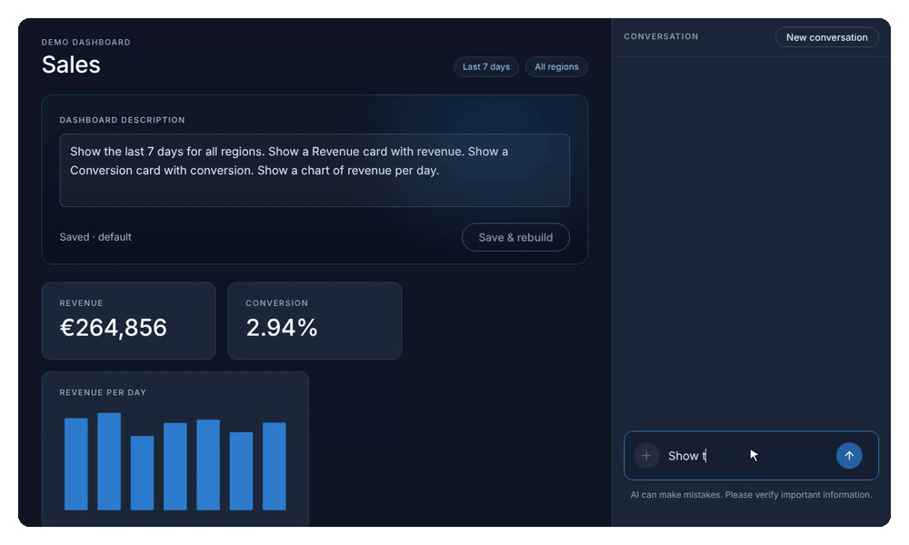
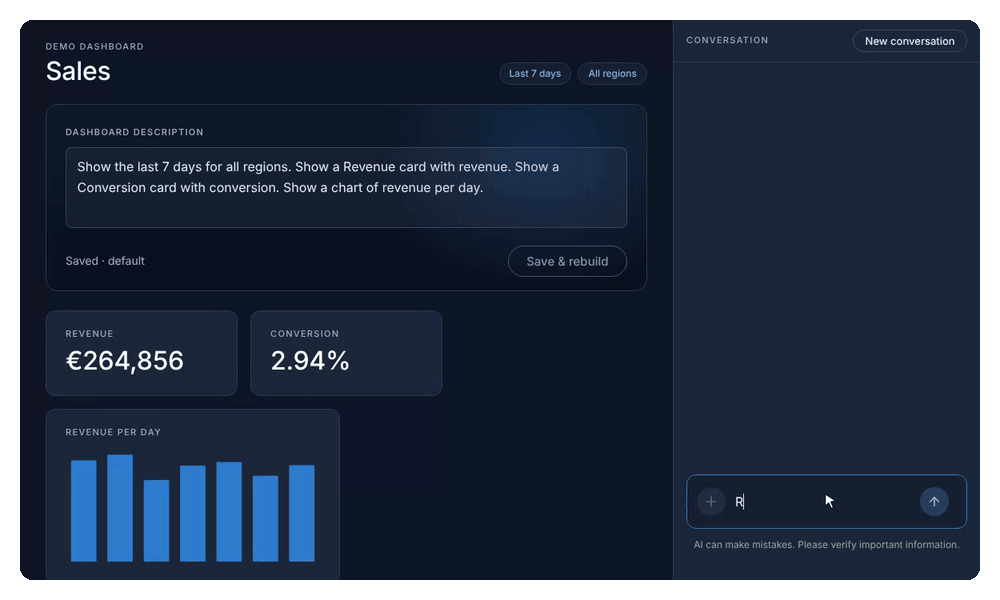

In the first four parts of this series, everything lived in the browser. The dashboard was saved in `localStorage`, the agent saw it because the app sent it along as context with every message, and the conversation itself was gone the moment you reloaded the page. [Part 4](https://www.heckerssoftware.com/blog/copilotkit-angular-human-in-the-loop/) even had a section about it: reload while the agent is asking a question, and the question disappears.

In this last part, the dashboard moves into the agent's *state*, and that state is stored with the conversation on the server. Reload the page, and the conversation, the dashboard and the cards in the chat all come back exactly as you left them. Restart the server, and they still do.



The interesting part turned out not to be the saving. It was a consequence I did not expect: once the agent can write the dashboard directly, the approval check from part 4 no longer protects anything, and the place to check changes moves to the server.

> Same setup as before: `@copilotkit/angular` 0.6.0 with Angular 22.2 and `@copilotkit/runtime` 1.84, now with `@copilotkit/sqlite-runner` 1.84 on the server. Everything was run in a real browser. The recordings use a scripted test model instead of a paid one; everything else is real.

## Context, state and threads

Three words do a lot of work in this part, so first what each means.

Context is what the app tells the agent, read-only. Since part 1, the app has sent the dashboard as context with every message. The agent can read it, but it cannot change it; it changes things through tools.

State is a value both sides can read and change. The browser sends it along with every run, and the agent changes it by sending state events back: a complete new value, or a JSON Patch with only the differences. A change from the agent reaches the browser right away. A change from the browser reaches the server with the next run, which turns out to matter, as you will see.

A thread is one conversation, identified by a `threadId`. The runtime has a *runner* that stores every run of a thread: the messages, the tool calls, and the state events. When the browser connects to a thread, the runner replays it, and the conversation and the state are rebuilt from what happened.

Put together: if the dashboard lives in the state, it is stored with the conversation, and it comes back with it.

## What the agent does with state

Before changing any code, I wanted to know what `BuiltInAgent` does with state, because that decides what the model sees. So I read the runtime's source and logged the prompt again.

It does two things. First, it puts the state in the system prompt, under a heading of its own:

```
## Application State
This is state from the application that you can edit by calling AGUISendStateSnapshot or AGUISendStateDelta.
{
  "dashboard": {
    "description": "Show the last 7 days for all regions. Show a Revenue card with revenue. …",
    "spec": { "days": 7, "region": "All", "widgets": [ … ] }
  }
}
```

Second, it gives the model two tools of its own: `AGUISendStateSnapshot`, which replaces the whole state, and `AGUISendStateDelta`, which changes parts of it with a JSON Patch. They run on the server, inside the agent, and their results become the state events the browser receives.

Their input schema is `z.any()`. Anything the model sends is accepted.

That is the consequence I mentioned. In part 4, the agent changed the dashboard through `apply_dashboard`, a tool in the browser whose handler refused removals nobody had approved. With the dashboard in the state, the agent has a second way in, and the prompt literally tells it about it. A model that writes the state directly skips `apply_dashboard`, and its check, entirely.

So this version has one way in instead of two. `apply_dashboard` is gone. The agent changes the dashboard by writing state, and every write passes a check on the server. More on that check in a moment; first, the saving.

## A runner that keeps conversations

The runner is configured on the runtime:

```ts
// server.mjs
import { CopilotRuntime, BuiltInAgent } from '@copilotkit/runtime/v2';
import { SqliteAgentRunner } from '@copilotkit/sqlite-runner';

const runtime = new CopilotRuntime({
  agents: { default: agent },
  // Stores each conversation (its messages and its state) in a SQLite file, so a reload reconnects to it,
  // and so does a restart of this server. The default, InMemoryAgentRunner, forgets everything on a restart.
  runner: new SqliteAgentRunner({ dbPath: './threads.db' }),
});
```

Without a `runner`, the runtime uses `InMemoryAgentRunner`. It already keeps conversations, so a page reload works with it too. I tested both: with the in-memory runner, restarting the server loses every conversation, and the page quietly falls back to the default dashboard. With `SqliteAgentRunner`, the conversation and the dashboard survive the restart. It is a separate package, `@copilotkit/sqlite-runner`, with `better-sqlite3` as a peer dependency.

## The browser remembers which conversation

The browser has to know which thread to reconnect to. That is one id, saved in `localStorage`, and passed to the chat:

```ts
@Component({
  selector: 'app-root',
  template: `
    <main>…</main>
    <aside appHoldSendWhileAsking>
      <div class="chat-bar">
        <span class="eyebrow">Conversation</span>
        <button type="button" class="secondary" [disabled]="busy()" (click)="newConversation()">New conversation</button>
      </div>
      <copilot-chat [threadId]="threadId()" />
    </aside>
  `,
})
export class App {
  /** The conversation to continue. Saved so a reload reconnects to it, messages and dashboard both. */
  protected readonly threadId = signal(localStorage.getItem(THREAD_KEY) ?? crypto.randomUUID());
  // …
}
```

When `<copilot-chat>` gets a `threadId`, it connects to that thread, and the runner replays it. The messages come back, the cards from parts 3 and 4 come back, because they are rendered from the tool calls in those messages, and the state comes back.

Everything the dashboard needs is in that thread now, which is why `localStorage` keeps only the id. The dashboard itself no longer lives there.

## The dashboard moves into the state

The store from part 2 kept the active dashboard in a signal backed by `localStorage`. Now it reads it from the agent's state:

```ts
/** What the Angular app and the agent share. The dashboard is the only part this app uses. */
export interface SharedState {
  dashboard?: ActiveDashboard;
}

@Injectable({ providedIn: 'root' })
export class DashboardStore {
  readonly #agent = injectAgentStore('default');

  /**
   * The dashboard from the agent's shared state. The server checked it before it got here;
   * the shape is checked again before drawing it, so a thread saved by an older version cannot break the page.
   * Linked, so a change made in the browser shows at once, before the server has recorded it.
   */
  readonly active = linkedSignal<unknown, ActiveDashboard>({
    source: () => (this.#agent().state() as SharedState | undefined)?.dashboard,
    computation: (incoming, previous) => {
      const parsed = activeDashboard.safeParse(incoming);
      // A conversation without a dashboard yet keeps the one on screen, instead of flashing the default.
      return parsed.success ? parsed.data : (previous?.value ?? DEFAULT_DASHBOARD);
    },
  });
  // description, spec, totals and the rest are computed from active(), as before
}
```

`injectAgentStore` from part 2 has a `state` signal next to `messages` and `isRunning`. The store follows it with a `linkedSignal`, for two reasons. It is writable, so a change the browser makes itself, like Undo, shows at once. And its computation gets the previous value: when a conversation has no dashboard yet, for example a new one, the dashboard on screen stays, instead of jumping back to the default.

`activeDashboard` is a zod schema for the whole dashboard, built from the same pieces as the tool schemas in part 2. They moved into their own file, `dashboard.schema.ts`, so the store and the tools use the same shape. The server has a copy of its own, which I come back to at the end.

The context from part 1 stays, with a smaller job. The dashboard itself is in the state, which the agent sees in its prompt. The context now carries only what the agent may read but not change: the totals behind the dashboard.

```ts
connectAgentContext(
  computed(() => ({
    description: 'Totals for the dashboard as it is now, read-only',
    value: JSON.stringify({ totals: store.totals(), revenueByRegion: store.revenueByRegion() }),
  })),
);
```

That is a useful rule of thumb: state is what both sides change, context is what the agent may read.

## The server checks every change

Now the check. My first idea was to keep it in the browser: look at every state change as it arrives, and put the old dashboard back when it is not allowed. Two things I had already tested rule that out. A dashboard the agent writes is stored by the runner, and comes back after a reload. A dashboard the browser sets itself is not, and is gone after a reload. Put together: a browser check could correct the screen, but the thread on the server would keep the refused dashboard, and the next reload would bring it back. By the time the browser sees a change, it has already been stored. The check has to happen before that, on the server.

AG-UI agents support *middleware*: a function that sits between the runtime and the agent, and sees every event before it goes anywhere. The guard is a middleware on the agent:

```ts
// server.mjs
const agent = new BuiltInAgent({ model, prompt: /* the dashboard rules, see below */ });

// Every state change passes the guard before the runner stores it or the browser sees it.
agent.use(guardDashboard);
```

Here is the heart of it, from `dashboard-guard.mjs`:

```ts
export function guardDashboard(input, next) {
  if (input.forwardedProps?.syncOnly) return recordBrowserState(input);

  let state = input.state ?? {};
  const approved = approvedInThisTurn(input.messages);
  const writes = new Map(); // toolCallId -> { name, args }

  return next.run(input).pipe(
    concatMap((event) => {
      switch (event.type) {
        case EventType.TOOL_CALL_START:
          if (STATE_TOOLS.has(event.toolCallName)) writes.set(event.toolCallId, { name: event.toolCallName, args: '' });
          return [event];

        case EventType.TOOL_CALL_ARGS:
          if (writes.has(event.toolCallId)) writes.get(event.toolCallId).args += event.delta;
          return [event];

        // The agent's own state events are dropped; an accepted write is re-emitted below.
        case EventType.STATE_SNAPSHOT:
        case EventType.STATE_DELTA:
          return [];

        case EventType.TOOL_CALL_RESULT: {
          const write = writes.get(event.toolCallId);
          if (!write) return [event];
          const verdict = check(state, write, approved);
          if (!verdict.ok) {
            return [{ ...event, content: JSON.stringify({ applied: false, error: `Not applied. ${verdict.error}` }) }];
          }
          const appliedAt = new Date().toISOString();
          const previous = state.dashboard;
          state = { ...verdict.state, dashboard: { ...verdict.state.dashboard, updatedAt: appliedAt } };
          // The shape the change card from part 3 reads: what it was, what it is now, and when.
          const result = { applied: true, appliedAt, previous, description: state.dashboard.description, spec: state.dashboard.spec };
          return [{ ...event, content: JSON.stringify(result) }, { type: EventType.STATE_SNAPSHOT, snapshot: state }];
        }

        default:
          return [event];
      }
    }),
  );
}
```

It collects the arguments of every call to one of the two state tools. When the tool's result comes by, it works out what the state would become, a whole new value for a snapshot or the current state with the patch applied for a delta, and then decides. The agent's own state events never get through: an accepted change is sent as a new snapshot, with a time stamp from the server; a refused one is not sent at all.

`check` does two things. It validates the new dashboard with a zod schema, the same shape as in the browser. And it compares the widgets before and after: every widget that would disappear needs the user's approval.

That approval comes from the conversation itself:

```ts
/**
 * Widgets the user approved removing in this turn: confirm_removal answers after the last user message.
 * An approval does not carry over to a later message, so an old "yes" cannot be reused.
 */
function approvedInThisTurn(messages) {
  const lastUser = messages.findLastIndex((m) => m.role === 'user');
  const turn = messages.slice(lastUser + 1);
  // … find the confirm_removal answers in `turn` and collect their approvedKeys
}
```

The human-in-the-loop card from part 4 is unchanged, apart from one field: its answer now also lists the approved widgets by key, `approvedKeys`, which is what the server compares. The answer is a tool result in the conversation, so the server can read it like any other message. And because it only counts the answers after the last user message, an approval is only good for the turn it was given in. That also fixes the loose end from part 4, where an approval that was never used stayed valid forever.

What I tested, each in the browser against the real runtime:

- An agent that removes a widget without asking: refused, both through a snapshot and through a JSON Patch. The chat shows "Not applied. Removing the Revenue card needs the user's approval: call confirm_removal first."
- An agent that writes something the app cannot draw, 400 days for a region called "Mars": refused with the zod message, "The dashboard is not valid: spec.days Too big: expected number to be <=90."
- An approval reused a message later: the user approves removing a card, undoes it, and in the next message the agent removes it again without asking. Refused.
- A reload after the refused changes: the dashboard was unchanged. They never reached the thread.

The guard also rewrites the result of every state write into the shape the change card from part 3 already reads: what the dashboard was, what it is now, and when it was applied. In the browser, the card only needed a new registration. Part 3 mentioned `registerRenderToolCall` as the way to draw a tool the agent has on its own, and these are exactly such tools:

```ts
// The agent changes the dashboard by writing state, with tools that run on the server.
// The server's guard rewrites their results into the shape the change card from part 3 reads.
registerRenderToolCall({ name: 'AGUISendStateSnapshot', args: z.any(), component: DashboardChange });
registerRenderToolCall({ name: 'AGUISendStateDelta', args: z.any(), component: DashboardChange });
```

The rules the old `apply_dashboard` description carried moved into the agent's prompt on the server: change the dashboard with `AGUISendStateSnapshot`, send the complete spec with a matching description, and ask before removing anything.

One more detail, because it is easy to get wrong. The model sees the result of the built-in state tools, `success: true`, not the guard's verdict, if it gets another step in the same run. `BuiltInAgent` leaves the step limit to the AI SDK unless you set `maxSteps`, and the SDK's default is one step. In my tests, every change was a single model call, and the run ended after the state tool. Keep it that way, or the model may announce a change the guard has just refused. The change card is the answer.

## Changes made in the browser

Undo from part 3 and "Add to dashboard" change the dashboard without the agent. My first version did what seemed obvious: write the new dashboard into the agent's state with `agent.setState()` in the browser. It showed on screen, and was gone after a reload.

The reason is the runner. It stores what a run produces, and `setState` is not a run: it only changes the state in the browser. The server does see the new value, as the input of the next run, and the runner even keeps that input. But when it replays a thread, the state is rebuilt from the state events the runs sent back, not from what they were given.

So the browser records its changes with a run of its own, one that does not call the model. The guard short-circuits it:

```ts
// in DashboardStore
#sync(): void {
  this.#syncPending.set(false);
  void this.#copilotKit.core.runAgent({
    agent: this.#agent().agent,
    forwardedProps: { syncOnly: true, dashboard: this.active() },
  });
}
```

```ts
// in dashboard-guard.mjs
function recordBrowserState(input) {
  const { threadId, runId } = input;
  const sent = input.forwardedProps.dashboard ?? input.state?.dashboard;
  const parsed = dashboardSchema.safeParse(sent);
  const events = [{ type: EventType.RUN_STARTED, threadId, runId }];
  if (parsed.success) {
    const updatedAt = sent.updatedAt ?? new Date().toISOString();
    events.push({ type: EventType.STATE_SNAPSHOT, snapshot: { ...input.state, dashboard: { ...parsed.data, updatedAt } } });
  }
  events.push({ type: EventType.RUN_FINISHED, threadId, runId });
  return from(events);
}
```

A run with `syncOnly` never reaches the model. The guard answers it with a start, the dashboard as a snapshot, and an end, and the runner stores it like any other run. I checked: Undo makes no model call, and a reload right after it keeps the undo.


Two things here came out of testing.

The dashboard travels in `forwardedProps`, not only in the state. When the chat has just switched to a new conversation, the agent's state is reset before the request goes out. A sync that relied on the state recorded an empty one. Sending the dashboard explicitly makes it independent of that timing.

A sync waits until nothing else is happening. A thread has one run at a time, so the sync waits while the agent works. And while a question from part 4 is open, a new run does something worse: the question belongs to a run that is waiting for the answer, and starting another run aborts it. I tested it: an Undo while the agent was asking, then an answer, and nothing happened; the answer had nobody to go to. So the sync waits for both, with the `OpenQuestions` service from part 4:

```ts
// A browser change is recorded once nothing else is going on. A new run would abort an open question
// (the run it belongs to is waiting for the answer), so the sync waits for the answer too.
effect(() => {
  if (!this.#syncPending() || this.#agent().isRunning() || this.#questions.any()) return;
  untracked(() => this.#sync());
});
```

## Loading without a flash

With the dashboard coming from the server, a reload has a moment where the page is there but the conversation is not yet. The first recordings showed it: for about a third of a second, the default dashboard appeared, and then the saved one replaced it. That is not cosmetic. It shows the user, briefly, a dashboard they do not have.

So the dashboard waits until the conversation has loaded:

```ts
/**
 * False until the conversation has loaded. Until then the default dashboard would show for a moment
 * before the saved one replaces it. Connecting marks the agent as running, so the first time it stops
 * running, the conversation is loaded. The timeout keeps the page usable if the runtime cannot be reached.
 */
readonly loaded = signal(false);

constructor() {
  let wasRunning = false;
  effect(() => {
    const running = this.#agent().isRunning();
    if (wasRunning && !running) this.loaded.set(true);
    wasRunning = running;
  });
  setTimeout(() => this.loaded.set(true), 3000);
  // …
}
```

```html
@if (store.loaded()) {
  <app-dashboard [busy]="busy()" (rebuild)="rebuild($event)" />
} @else {
  <p class="loading" role="status">Loading the conversation…</p>
}
```

My first version also counted "the state has a dashboard" as loaded. It did not help, and tracing it showed why: the store itself wrote the default into the state for an empty conversation, before the saved one arrived. So that write now waits for `loaded` as well. With both in place, a reload goes from blank straight to the saved dashboard.

## Starting a new conversation

A saved conversation raises the next question: how do you start a new one? That is a new thread id. The only decision is which dashboard a new conversation starts with. I chose the one on screen, so starting over in the chat does not reset your dashboard:

```ts
/** A new thread on the server. It starts from the dashboard on screen, which is recorded in it right away. */
protected newConversation(): void {
  const id = crypto.randomUUID();
  localStorage.setItem(THREAD_KEY, id);
  this.threadId.set(id);
  // The chat moves the agent to the new thread while it renders; record the dashboard after that.
  afterNextRender(() => this.store.record(), { injector: this.injector });
}
```

`record()` marks the dashboard on screen for a sync, which then lands in the new thread. I tested the whole round: change the dashboard, start a new conversation, change it again there, then switch back to the first id. Each conversation had its own dashboard and its own messages.

Note what is missing: a list of conversations. With `SqliteAgentRunner` 1.84, the runtime does not offer an endpoint to list threads; its info endpoint reports all thread endpoints as unavailable. Connecting and running work, listing does not. If you want a list, keep the thread ids per user in your own backend. Renaming and deleting threads, according to the runtime's source, need CopilotKit's hosted platform.

## The question survives a reload

Part 4 ended with a known limit: reload while the agent is asking, and the question is gone. With the conversation stored on the server, it is not. The tool call is part of the thread, so it is replayed, and the card comes back with its buttons, still waiting. I answered it after the reload, and the agent continued as if nothing had happened.



## What to keep an eye on

A thread id is a key. Without a user identity on the runtime, anyone who has a thread's id can connect to it and continue it. I tested it: a second browser with nothing but the id loaded the conversation and changed the dashboard. Give the runtime an `identifyUser` function, so each thread belongs to the user who started it:

```ts
const runtime = new CopilotRuntime({
  // In a real app: the user from your session or token, after the authentication from part 1.
  identifyUser: (request) => ({ id: userIdFrom(request), name: userNameFrom(request) }),
  agents: { default: agent },
  runner: new SqliteAgentRunner({ dbPath: './threads.db' }),
});
```

I tested that too, with two users and one thread id: the owner kept full access, and the other user saw an empty conversation, and could not change the dashboard. Note that the refusal is silent in the chat: the second user's message simply got no answer. If users can end up on someone else's link, handle that case in your own UI.

The state is in every prompt. Everything in it is sent to the model with every message. A dashboard spec is small. Keep it that way: put what the agent only needs to read in context, and large data behind a tool.

Two copies of the schema. The browser and the server each validate the dashboard, so they must agree. Here, the server has a JavaScript copy of the TypeScript schema. In a monorepo, make it one library both import.

The guard protects against the model, not against the user. It trusts the state the browser sends as the starting point, because the dashboard is the user's own. When the state holds something users must not change, check it against your own data on the server instead.

One server, one file. `SqliteAgentRunner` stores threads in a local file. Several runtime instances behind a load balancer need threads in a shared store: CopilotKit's hosted platform, or an `AgentRunner` of your own on a shared database.

## Wrapping up the series

Five parts, one dashboard. Part 1 gave the agent eyes and hands: context to see the dashboard, tools to change it. Part 2 made the dashboard a saved description with a spec behind it. Part 3 put Angular components in the chat, part 4 made the agent ask before it removes anything, and this part moved the dashboard to the server, where the conversation lives and where every change is checked.

The thread through all of it is the same idea: the model decides what to ask for, and your code decides what happens. In part 1, that was a narrow schema on a tool. In this part, it is a guard on the server that sees every change before it is stored.

If you want to bring features like this into your own Angular application, my workshop [AI-Native Development: From Autocomplete to Automation](https://heckerssoftware.com/services/workshops#ai) covers them on your own codebase. Or [get in touch](https://heckerssoftware.com/#contactForm) if you would like help building it with your team.
